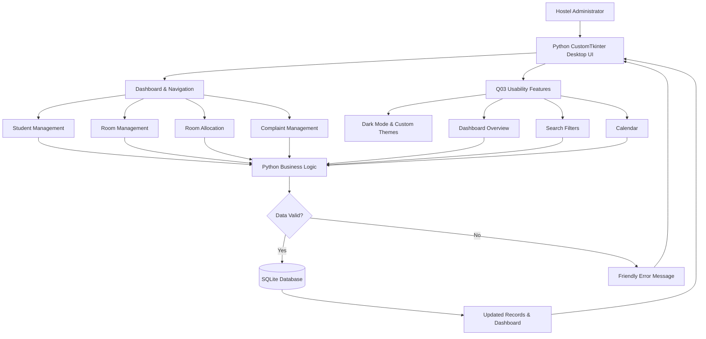

# Hostel Management System — System Architecture

**Course:** BBAT104 — Fundamentals of TQM  
**Quality Goal:** Q03 — Improve Usability  
**Status:** Proposed Architecture — Review 1

## System Architecture Flowchart

## Architecture Explanation

1. **Hostel Administrator:** The main user of the application.
2. **CustomTkinter UI:** Provides forms, navigation, dashboard and usability features.
3. **Core Modules:** Manage students, rooms, allocations and complaints using CRUD operations.
4. **Business Logic:** Processes requests and checks validation rules.
5. **SQLite Database:** Stores hostel management records locally.
6. **Validation:** Prevents invalid or duplicate data and room over-allocation.
7. **Q03 Features:** Improve usability through themes, dashboard, filters and calendar.

## Technology Stack

- Python 3
- CustomTkinter
- SQLite
- Matplotlib for later TQM analysis

## Note

This architecture represents the planned application. Implementation and testing will be performed in later project reviews.
